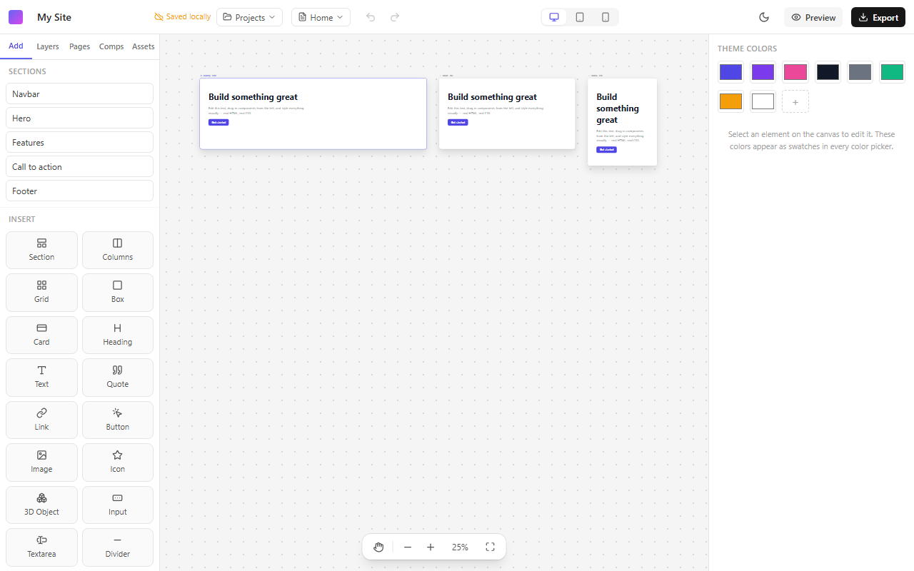

# Prism — Drag-and-Drop Website Builder with 3D 🌱

Prism is a browser-based visual website builder. Drag UI elements (and **Three.js
3D objects**) onto a freeform canvas, edit them in a property inspector, preview
responsively, save projects to PostgreSQL, and export a standalone HTML/CSS/JS site.

> Built with React + Vite + Tailwind (client) and Express + PostgreSQL (server) in
> an npm-workspaces monorepo.



## About

Prism is a visual website builder that runs in the browser and can place Three.js 3D models next to regular page elements. It is for designers and developers who want to lay out a page freely and export plain HTML/CSS/JS instead of being locked into a hosted builder. This is version 1: the editor, 3D support, PostgreSQL saving and export work, with the limitations listed below.

## Features

- **Real HTML/CSS canvas** — the page renders in an iframe with real CSS layout.
  Insert elements from the Add panel, drag to reorder, double-click text to edit it
  in place.
- **Section templates** — Navbar, Hero, Features, Call to action and Footer, each
  responsive out of the box (columns stack and type scales down on phones).
- **Elements** — Section, Columns, Grid, Box, Card, Heading (h1–h6), Text, Quote,
  Link, Button, Image, Icon, Input, Textarea, Divider, Spacer and **3D Object**.
- **Framer-style style panel** — size modes (Fill/Fit/Fixed/Relative), Stack/Grid/Block
  layout, position (Flow/Absolute/Fixed/Sticky), transforms, appearance, filters,
  typography, backgrounds, borders and an alignment toolbar.
- **Breakpoints** — Desktop (1280), Tablet (768) and Mobile (390) frames side by side
  on an infinite zoom/pan canvas; each style can be set per breakpoint.
- **Hover & pressed effects** — Normal / Hover / Pressed switch with one-click
  presets (Lift, Grow, Glow, Dim, Press, Sink) and smooth transitions.
- **Scroll animations** — 8 entrance presets, timing, stagger for card rows,
  previewed in the editor and working in the exported site (respects reduced motion).
- **Free positioning** — make any element absolute and move/resize it with handles,
  snapping and guides.
- **Components** — turn any subtree into a reusable component; instances stay in sync,
  with variables and per-instance overrides. A component can't be nested in itself.
- **3D Object** — a live three.js primitive (box, sphere, torus, cone, torus knot)
  with material controls and auto-rotate; it is also rendered in the exported site.
- **Pages, design tokens, asset library**, dark editor theme, undo/redo
  (Ctrl/Cmd+Z, Ctrl/Cmd+Shift+Z) and keyboard shortcuts.
- **Persistence** — autosave to localStorage (flushed when the tab is hidden or
  closed, so the last edit is never lost) and to PostgreSQL when the API has a
  database.
- **Code export** — one self-contained HTML file per page (a ZIP for multi-page
  sites) with responsive media queries.

## Prerequisites

- Node.js 18+
- Docker (optional, for the local PostgreSQL) — or any PostgreSQL reachable via
  `DATABASE_URL`. **Postgres is optional for local use**: without it, projects
  autosave to your browser's localStorage.

## Quick start

Run each command on its own line. On Windows `cmd`, do **not** paste trailing
`#` comments — `cmd` passes them to the program as arguments.

1. Create your `.env`:
   - **Windows:** `copy .env.example .env`
   - **macOS/Linux:** `cp .env.example .env`
2. *(Optional)* start PostgreSQL for cloud persistence: `docker compose up -d db`
3. Install dependencies: `npm install`
4. *(Optional)* apply database migrations: `npm run migrate`
5. Run client + server together: `npm run dev`

- Editor: **http://localhost:5173**
- API: **http://localhost:9998**

If PostgreSQL isn't running, the server still starts and the editor works —
projects save to localStorage and the save indicator shows "Saved locally".
The API port is configurable via `PORT` in `.env`.

## Scripts

| Command | Description |
|---|---|
| `npm run dev` | Run client (Vite) + server (Express) together |
| `npm run build` | Production build of the client |
| `npm run migrate` | Apply SQL migrations to PostgreSQL |
| `npm test` | Run all tests (client + server) |
| `npm run test:client` / `npm run test:server` | Run one workspace's tests |

## Project structure

```
client/   React + Vite editor
  src/
    main.jsx            entry: mounts builder/BuilderApp
    builder/
      components.jsx    element registry (tag, default props/styles, icon)
      store.js          Zustand document store (zundo undo/redo) + UI store
      model.js          tree helpers (subtrees, parents, canvas root, components)
      Canvas.jsx        infinite canvas; DeviceFrame.jsx renders one breakpoint iframe
      InstanceRender.jsx  renders the instance tree as real HTML
      cssGen.js         styles map -> CSS (shared by canvas and export)
      exportSite.js     standalone HTML / ZIP export (loaded on demand)
      templates.js      section templates
      autosaver.js, useAutosave.js, persist.js   saving
      StylePanel.jsx, panels/   the style/inspector UI
server/   Express + node-postgres
  src/
    app.js      express app factory (DI repo for testing)
    repo.js     PostgreSQL data access
    routes/     projects + assets
    migrations/ ordered SQL, applied on startup
docs/     specs, plans and the component guide
```

## How it works

A project is one serializable JSON document: `pages` (each with a root instance),
a flat `instances` map (`{ id, component, props, children }`), a `styles` map
(`{ [id]: { base, tablet, mobile } }` of CSS declarations), `components`, design
`tokens` and `assets`. It lives in a Zustand store with `zundo` for undo/redo and is
saved to localStorage and, when available, to PostgreSQL as `jsonb`. The canvas and
the exporter both turn the `styles` map into CSS with `cssGen.js`, so what you see is
what you export.

## Extending

- **Add an element:** [docs/adding-components.md](docs/adding-components.md)

## Deployment

- **Client:** `npm run build` → static files in `client/dist/` (any static host).
  Set `VITE_API_BASE` to your API origin at build time if it differs.
- **Server:** deploy `server/` to any Node host; set `DATABASE_URL` and `PORT`,
  run `npm run migrate`, then `npm start`. Uploaded assets are stored on disk under
  `server/uploads/` (mount a persistent volume in production).

## Known limitations

- 3D Objects are built-in primitives; importing GLTF/GLB models is not supported yet.
- Each 3D object uses its own WebGL context; browsers cap concurrent contexts
  (~16), so keep the number of simultaneous 3D objects modest.
- Images are stored inside the project as data URLs, so very large images can fill
  the browser's localStorage (the save chip turns red: "Not saved").
- The API has no authentication. It only answers cross-origin requests from
  localhost by default; don't expose it to the internet as is.

## Testing

`npm test` runs Vitest across both workspaces: the document store, autosave,
templates, layout, transforms, CSS generation and export (including injection
cases), and the server API (via an in-memory repo, no database required).
